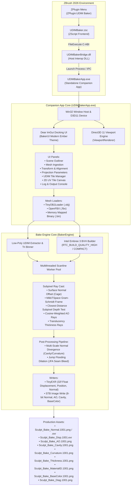

# ZBrush UDIM Baker — System Architecture Specification

## 1. Executive Summary & Purpose

The **ZBrush UDIM Baker** is a high-performance hardware-accelerated baking suite for Maxon ZBrush. It eliminates the traditional bottlenecks of baking massive high-resolution digital sculpts (20M–100M+ polygons) onto production low-poly assets with modern **UDIM multi-tile UV layouts**.

Rather than forcing artists through tedious manual PolyGroup-to-UV splitting or exporting prohibitive 10–30 GB OBJ files to third-party tools, the suite provides:
1. **Host Integration**: A one-click `ZPlugin:UDIM Baker` menu item inside ZBrush.
2. **Native C-ABI Bridge**: Rapid export and stream handling via `UDIMBakerBridge.dll`.
3. **Dedicated Standalone Companion App**: `UDIMBakerApp.exe` featuring an interactive Direct3D 11 3D viewport, 2D UV tile canvas, and Marmoset-inspired Ember dark docking workspace.
4. **Hardware Ray-Tracing Baker**: An Intel Embree 3-powered multithreaded ray tracer supporting subpixel antialiasing (AA), closest-hit depth testing, MikkTSpace tangent basis, and Jump Flooding dilation.

---

## 2. High-Level System Architecture



---

## 3. Component Deep Dive

### 3.1 Host ZScript Frontend (`UDIMBaker.txt` -> `UDIMBaker.zsc`)
* **Path**: `C:\Program Files\Maxon ZBrush 2026\ZStartup\ZPlugs64\UDIMBaker.zsc`
* **Sub-Palette**: `ZPlugin:UDIM Baker`
* **Workflow**:
  1. Artist clicks `Launch UDIM Baker`.
  2. ZScript queries active SubTool metrics and writes high-poly cache to `C:\Users\Public\Documents\ZBrushData2026\ZPluginData\UDIMBaker\UDIM_HighPoly.obj`.
  3. Executes `[FileExecute, "UDIMBakerData/UDIMBakerBridge.dll", "LaunchBakerSession", 0]`.

### 3.2 Host Bridge DLL (`UDIMBakerBridge.dll`)
* **Role**: C-ABI interop layer fulfilling ZBrush's strict calling convention:
  ```cpp
  #define DLL_EXPORT extern "C" __declspec(dllexport)

  DLL_EXPORT float LaunchBakerSession(
      char* pData,
      double optValue,
      char* pOutputBuffer,
      double* optOutputValue
  );
  ```
* **Process Spawning**: Uses `CreateProcessA` with `DETACHED_PROCESS` to spawn `UDIMBakerApp.exe` non-blocking so ZBrush remains responsive.

### 3.3 Standalone Companion Application (`UDIMBakerApp.exe`)
* **Framework**: Native Win32 + Direct3D 11 + Dear ImGui Docking Branch.
* **Palette Theme**: Marmoset Ember (`0x0E1014` dark slate background, `0x151922` panel body, `0xFF9E3B` amber accents).
* **Key Architecture Classes**:
  * [`UIManager`](file:///e:/CODES/zbrush%20plugins/baker/src/app/UIManager.h): Coordinates application state, dock layout, mesh ingestion, settings synchronization, and bake thread dispatching.
  * [`ViewportRenderer`](file:///e:/CODES/zbrush%20plugins/baker/src/app/ViewportRenderer.h): Manages D3D11 render targets, shaders, high-poly wire/shaded mesh display, low-poly cage visualization, and Orbit/Pan/Zoom camera math.
  * [`MeshLoader`](file:///e:/CODES/zbrush%20plugins/baker/src/app/MeshLoader.h): Universal parser supporting Wavefront OBJ (`tiny_obj_loader`), Autodesk FBX (`OpenFBX`), and binary vertex dumps. Preserves multi-tile UV coordinates, vertex colors (Polypaint), and face group IDs (Polygroups).

---

## 4. Ray-Tracing & Projection Mathematics

### 4.1 UDIM Tile Identification
UV coordinates spanning outside $[0, 1]$ are assigned to standardized UDIM tile integers:
$$\text{Tile ID} = 1001 + \lfloor u \rfloor + 10 \times \lfloor v \rfloor$$
For example:
* $u \in [0.0, 1.0), v \in [0.0, 1.0) \implies \text{UDIM } 1001$
* $u \in [1.0, 2.0), v \in [0.0, 1.0) \implies \text{UDIM } 1002$

### 4.2 Cage Generation & Ray Casting
If no custom cage mesh is loaded, the baker dynamically calculates an extruded cage vertex for every low-poly vertex:
$$V_{\text{cage}} = V_{\text{low}} + \vec{N}_{\text{low}} \times d_{\text{cage}}$$
Where $\vec{N}_{\text{low}}$ is the area-weighted smooth vertex normal.
The ray origin is placed at the interpolated cage position:
$$P_{\text{ray}} = P_{\text{low}} + \vec{N}_{\text{low}} \times d_{\text{cage}}$$
$$D_{\text{ray}} = -\vec{N}_{\text{low}}$$
$$\text{Max Distance} = d_{\text{cage}} + d_{\text{maxRay}}$$

### 4.3 MikkTSpace Orthonormal Tangent Basis
To eliminate normal map seams and shading distortions across major 3D game engines (Unreal Engine 5, Unity HDRP, Blender, Maya), the baker computes the per-pixel tangent frame via Gram-Schmidt orthonormalization:
$$\vec{N} = \text{normalize}(\vec{N}_{\text{interpolated}})$$
$$\vec{T} = \text{normalize}(\vec{T}_{\text{interpolated}} - \vec{N} \cdot (\vec{N} \cdot \vec{T}_{\text{interpolated}}))$$
$$\vec{B} = \text{normalize}(\vec{N} \times \vec{T}) \times \text{sign}$$
Tangent space normal components are projected via dot products:
$$N_{\text{tangent}} = \begin{bmatrix} \vec{N}_{\text{high}} \cdot \vec{T} \\ \pm (\vec{N}_{\text{high}} \cdot \vec{B}) \\ \vec{N}_{\text{high}} \cdot \vec{N} \end{bmatrix}$$
*(The bitangent sign $Y$ can be inverted on-the-fly for DirectX $-Y$ vs OpenGL $+Y$ formats).*

### 4.4 Closest-Distance Subpixel Depth Testing
To solve overlapping UVs (e.g. instanced duplicate modular pieces or mirrored limbs sharing UV islands), the accumulator tracks individual subpixel hits:
$$\text{Hit Distance} = |\Delta| = |(P_{\text{high}} - P_{\text{low}}) \cdot \vec{N}|$$
When multiple low-poly triangles cover the same pixel sample $(x, y, s)$:
$$\text{sample}(x, y, s) = \arg\min_{\text{hits}} (\text{Hit Distance})$$
This guarantees that **the surface closest to the high-poly sculpt wins**, completely eliminating washed-out averages and stray rays from duplicate pieces floating in empty space.

### 4.5 Jump Flooding Dilation Algorithm (JFA)
To eliminate black pixel seams at UV island borders during mipmapping and texture filtering, the baker applies Jump Flooding Dilation ($O(N \log N)$ complexity):
1. **Seed Initialization**: Valid UV hit texels initialize their coordinate seeds $(\text{seed}_x, \text{seed}_y) = (x, y)$. Background pixels are set to $(-1, -1)$.
2. **Exponential Step Reduction**: For step sizes $k \in \{\frac{W}{2}, \frac{W}{4}, \dots, 2, 1, 1\}$, texels query their 8 neighbors at offset $\pm k$:
   $$\text{dist}^2 = (x - \text{seed}_x)^2 + (y - \text{seed}_y)^2$$
3. **Seam Dilation**: Pixels within `paddingPixels` radius copy their nearest valid neighbor's normal, displacement, AO, and cavity values.

---

## 5. Output Map Suite Specifications

| Map Name | Bit Depth / Format | Normalization / Channel Layout | Algorithm Description |
|---|---|---|---|
| **Tangent Normal** | 16-bit Half EXR / 8-bit PNG | RGB in $[0, 1]$, $Z$ up | MikkTSpace tangent-space normal vector with subpixel AA and JFA seam bleed. |
| **World Normal** | 16-bit Half EXR / 8-bit PNG | RGB world vector in $[0, 1]$ | Object/world-space normal vector for shader triplanar mapping. |
| **Displacement** | 32-bit Float EXR | Unclamped signed float (world units) | Exact scalar height delta $\Delta = (P_{\text{high}} - P_{\text{low}}) \cdot \vec{N}$. |
| **Ambient Occlusion** | 16-bit Float EXR / 8-bit PNG | Grayscale in $[0, 1]$ | Cosine-weighted hemispherical ray casting ($16$–$64$ rays per hit). |
| **Cavity** | 16-bit Float EXR / 8-bit PNG | Grayscale in $[0, 1]$ | Multi-scale divergence of tangent normal gradients (pores, crevices, fissures). |
| **Curvature** | 16-bit Float EXR / 8-bit PNG | Grayscale ($0.0$=concave, $0.5$=flat, $1.0$=ridge) | Second-order surface Laplacian across normal fields. |
| **Thickness / SSS** | 16-bit Float EXR / 8-bit PNG | Grayscale in $[0, 1]$ | Inverted ray casting through mesh geometry for subsurface scattering depth. |
| **World Position** | 32-bit Float EXR | XYZ normalized $[0, 1]$ or unclamped world coordinates | Normalized bounding volume coordinates for gradient effects and mask generators. |
| **Material ID** | 16-bit Half EXR / 8-bit PNG | RGB distinct palette | Golden-ratio hue distribution per ZBrush PolyGroup ID. |
| **Base Color** | 16-bit Half EXR / 8-bit PNG | sRGB color | Interpolated ZBrush Polypaint vertex colors baked to UDIM texture. |
| **Diagnostic** | 16-bit Half EXR / 8-bit PNG | RGB indicator | Green = Clean hit, Red = Missed ray, Yellow = Cage clamp. |

---

## 6. Build and Runtime Dependencies

* **Intel Embree 3.13.5**: High-performance ray tracing kernels (uses `embree3.dll` bundled with ZBrush).
* **Intel TBB 2020.3**: Threading Building Blocks for multi-core scalability (uses `tbb12.dll` bundled with ZBrush).
* **DirectX 11 / D3DCompiler**: Hardware viewport rendering and shader compilation.
* **Dear ImGui (Docking Branch)**: Immediate mode GUI with multi-panel docking.
* **TinyEXR / TinyOBJLoader / OpenFBX**: Header-only robust asset serialization.
