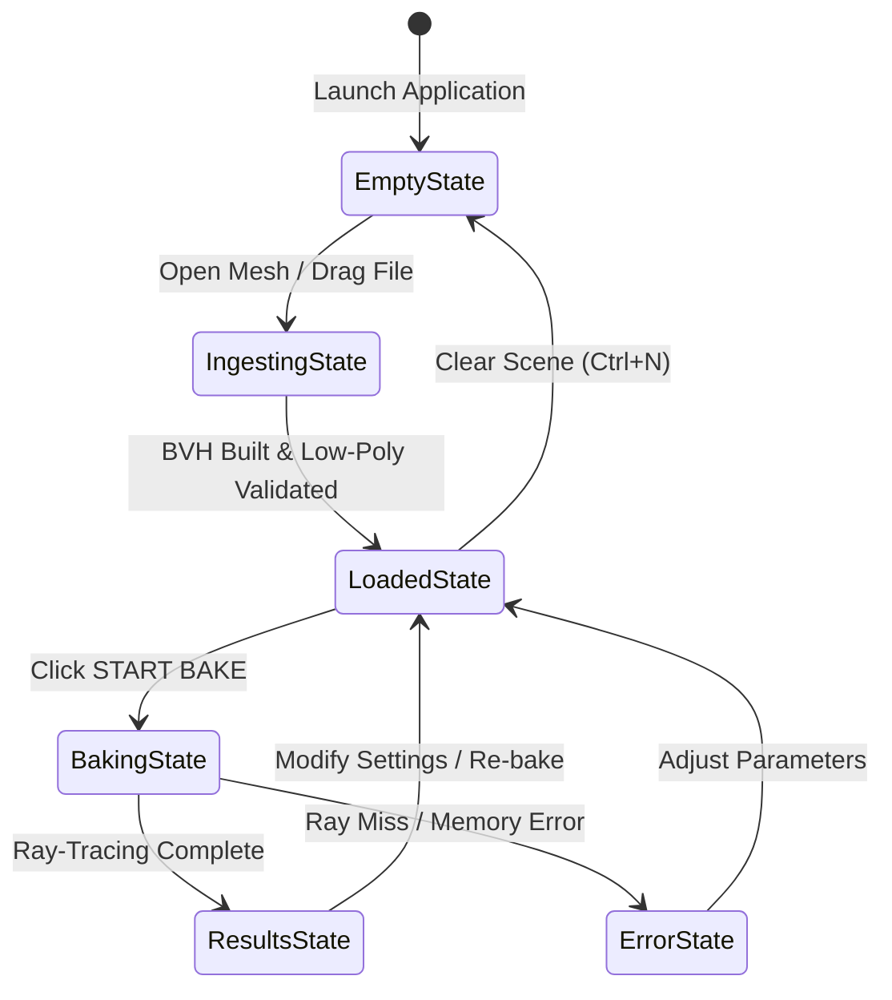

# Companion Baker UI Architecture & Design System Specification

## 1. Executive Summary & Design Identity
The **ZBrush UDIM Baker** companion application (`UDIMBakerApp.exe` and `StandaloneBaker.exe`) features a modern, docked 3D DCC interface modeled on Blender 4.x/5.1 and Marmoset Toolbag 4.
The interface is designed to handle high-frequency technical workflows (loading 50M+ polygon sculpts, setting up UDIM tiles, configuring ray-casting heuristics, and monitoring multi-threaded ray tracing) without visual clutter.

### Primary Visual Identity
- **Visual Theme**: Blender Dark (Default).
- **Background Color**: Deep Slate Charcoal (`#1D1D1D`).
- **Panel Surface**: Neutral Gray (`#282828`).
- **Elevated Insets & Cards**: Inset Gray (`#323232`).
- **Signature Accent**: Warm Blender Orange (`#E87D0D`), Hover (`#F68E28`), Active (`#B85F00`).
- **Typography**: Inter (14px base UI, 14px SemiBold headings) with JetBrains Mono (13.3px monospace log).
- **Window Rounding**: Subtle 4px radius on cards, buttons, tabs, and frames.

---

## 2. Technical Stack & Runtime Boundaries
- **GUI Framework**: Dear ImGui `v1.93.1 WIP` (Docking branch with multi-viewport support).
- **Renderer Backend**: DirectX 11 via `imgui_impl_dx11.cpp`.
- **Platform Backend**: Win32 via `imgui_impl_win32.cpp`.
- **3D Graphics Engine**: Custom Direct3D 11 hardware viewport (`ViewportRenderer.cpp`) rendering to an offscreen render target texture (`ID3D11ShaderResourceView*`) passed to `ImGui::Image`.
- **Layout Persistence**: Saved to `baker_layout.ini` (companion mode) or `standalone_baker_layout.ini` (standalone mode).

---

## 3. Screen Layout & Docking Architecture
The workspace uses a root DockSpace (`BakerDockSpace`) filling 100% of the window between the top menu bar and the bottom status bar.

### Docking Layout Diagram
```text
+---------------------------------------------------------------------------------------------+
| Main Menu Bar (File, View, Theme, Help)                                                     |
+----------------------------------------------------+----------------------------------------+
|                                                    | Scene Outliner (ID: 0x05, 30% width)   |
| Viewport (ID: 0x03, Central Node, No Tab Bar)      | - High-poly sculpt, Low-poly, Cage     |
| - 3D Direct3D 11 Hardware Render Target            +----------------------------------------+
| - Top Overlay Toolbar (Wireframe, Cage, Normals...) | Bake Parameters (ID: 0x06, Tab 1)      |
| - Floating Bake Bar (Bottom Center)                | Mesh Ingestion  (ID: 0x06, Tab 2)      |
|                                                    |                                        |
+----------------------------------------------------+                                        |
| UDIM Layout (ID: 0x04, Tab 1, 26% height)          |                                        |
| Output Log  (ID: 0x04, Tab 2, 26% height)          |                                        |
+----------------------------------------------------+----------------------------------------+
| Status Bar (Status bullet, active message, live FPS monitor)                                |
+---------------------------------------------------------------------------------------------+
```

### Programmatic Split Ratios (`BakerUI::BuildDefaultLayout`)
1. **Right Sidebar**: Split horizontally at **30% screen width** (70% Center Viewport, 30% Right Sidebar).
2. **Bottom Shelf**: Split vertically at **26% remaining screen height** (74% Viewport, 26% Bottom Shelf).
3. **Right Sidebar Split**: Split vertically at **58% lower height** (42% Top Outliner, 58% Parameters/Ingestion).
4. **Viewport Tab Strip**: Suppressed via `ImGuiDockNodeFlags_NoTabBar` to give the central 3D canvas a native viewport feel.

---

## 4. Comprehensive Window Breakdown

### 4.1 3D Viewport (`Viewport###viewport`)
The core interactive canvas for inspecting geometry, ray directions, and bake results:
- **DirectX 11 Integration**:
  - `ViewportRenderer` dynamically allocates offscreen backbuffers matching ImGui content size.
  - Orbit, Pan, and Dolly camera math executes when the viewport image is hovered.
- **Top Overlay Toolbar (Pill Chips)**:
  - `Wireframe`: Renders low-poly quad topology without diagonal split lines.
  - `Cage`: Displays expanded translucent cage envelope.
  - `Normals`: Visualizes vertex normal stalks.
  - `High-Poly`: Toggles high-poly sculpt rendering.
  - `Low-Poly`: Toggles low-poly game mesh rendering.
  - `Grid`: Displays Blender-style infinite anti-aliased ground grid.
  - `MatCap`: Switches between PBR studio lighting and clay MatCap.
  - `Reset Cam`: Reframes view around active mesh bounding box.
- **Floating Bake Bar (`FloatingBakeBar`)**:
  - Centered at the bottom of the viewport canvas.
  - Idle state shows detected UDIM tile count, bake resolution, and an orange `"START BAKE"` button.
  - Baking state morphs the bar into an animated progress bar displaying live percentage and active operation text.

### 4.2 Scene Outliner (`Scene Outliner###outliner`)
Tree-view asset hierarchy showing loaded objects:
- **High-Poly Sculpt Node**: Shows file path, vertex count, triangle count, and Intel Embree BVH build state pill (`"BVH Ready"`, `"Building..."`).
- **Low-Poly Target Node**: Shows file path, vertex count, polygon count, and detected UDIM tiles pill.
- **Cage Definition Node**: Displays procedural offset distance or explicit cage mesh.
- **Visibility Toggles**: Quick eye icons on each node toggle viewport rendering.

### 4.3 Mesh Ingestion (`Mesh Ingestion###ingest`)
File management and alignment panel:
- **High-Poly Card**: File path input, browse button, and SubTool metrics.
- **Low-Poly Card**: File path input, browse button, and detected UDIM tile indicators.
- **Transform Synchronization**: Buttons for `"Auto-Align Centers"`, `"Fit Scale"`, and `"Reset"`.
- **Cage Configuration**: Toggle between procedural normal offset and explicit morph cage.

### 4.4 Bake Parameters (`Bake Parameters###params`)
Configuration hub for ray-tracing heuristics:
- **Projection & Quality**: Resolution (`1024` to `8192`), Anti-Aliasing (`1x` to `4x4`), Skew factor, Cage offset, Max ray length, Seam padding (32px default), and Discard Backfaces.
- **Output Maps Suite**: Tangent Normal (MikkTSpace basis), World Normal, Displacement (32f EXR), Ambient Occlusion, Cavity, Curvature, Thickness, World Position, Material ID, Base Color, and Diagnostic Map.
- **Destination & Format**: Output directory picker, open in Windows Explorer button, 8-bit PNG vs 32-bit Float EXR checkboxes.
- **Bake Trigger**: Full-width in-panel `BakeButton` with animated progress morphing.

### 4.5 UDIM Layout (`UDIM Layout###udim`)
2D UV coordinate visualizer:
- **Coordinate Grid**: Displays tile squares (`[1001]`, `[1002]`, `[1003]`, etc.).
- **UV Wireframe**: Displays projected UV polygons within tile boundaries.
- **Tile Toggles**: Buttons to `"Select All"`, `"Select Only 1001"`, or `"Deselect All"`. Clicking tiles toggles inclusion.

### 4.6 Output Log (`Output Log###log`)
Real-time console for execution metrics:
- Color-coded text for `[System]`, `[Info]`, `[Warn]`, and `[Error]`.
- Controls for `"Clear"`, `"Copy All"`, and `"Auto-scroll"`.

### 4.7 Status Bar (`##statusbar`)
Anchored along the window bottom:
- Colored status indicator bullet (Green = Ready/Success, Amber = Working, Red = Error).
- Descriptive status message (e.g. `"BVH Ready (15,804,962 verts)"`, `"Baking completed in 18.4s"`).
- Live framerate monitor (`"%.0f FPS"`).

---

## 5. Application UI State Machine



1. **State 1: Empty**:
   - No meshes loaded; Viewport renders ground grid; Floating bar shows `"Load meshes in Mesh Ingestion tab"`.
2. **State 2: Ingesting**:
   - Files reading; Embree BVH building on background worker threads; Amber status pills active.
3. **State 3: Loaded**:
   - High-poly sculpt and low-poly target in memory; Watertight normals computed; Floating bar enabled in bright orange.
4. **State 4: Baking**:
   - Multi-threaded scanline ray casting running; Floating bar displays progress percentage; Modal progress dialog open.
5. **State 5: Results**:
   - Maps written to disk; Viewport updates with normal map preview; Log displays completion statistics.
6. **State 6: Error**:
   - Triggered on missing UVs or file read failure; Red status pills and warning tooltips displayed.

---

## 6. Widget Design System (`src/app/BakerUI.h`)
The application defines reusable custom widgets built on Dear ImGui primitives:
- **`SectionLabel(text)`**: Card-style section header with subtle border and bold text.
- **`PrimaryButton(label, w, h)`**: Solid orange action button (`#E87D0D`).
- **`SecondaryButton(label, w)`**: Subtle dark slate button (`#363636`).
- **`ToggleChip(label, bool* v)`**: Rounded pill toggle button with active orange highlight.
- **`StatusPill(text, color)`**: Rounded pill badge with colored indicator circle.
- **`BeginProps(id)` / `EndProps()`**: High-contrast two-column parameter table (42% label, 58% control).
- **`PropFloat`, `PropInt`, `PropCombo`, `PropCheck`**: Standardized parameter controls with tooltips.
- **`BeginCard(id)` / `EndCard()`**: Bordered rounded grouping container.
- **`BakeButton(progress)`**: Action button that morphs into a progress bar during baking.
- **`FloatingBakeBar(...)`**: Responsive floating viewport HUD for instant baking.

---

## 7. UI Handoff Package & Further Documentation
For detailed widget tables, layout coordinates, source code, and known issues:
- **UI Inventory**: [`docs/ui_handoff/UI_INVENTORY.md`](file:///e:/CODES/zbrush%20plugins/baker/docs/ui_handoff/UI_INVENTORY.md) (Every widget, label, state variable, and callback).
- **Known Layout Issues**: [`docs/ui_handoff/KNOWN_ISSUES.md`](file:///e:/CODES/zbrush%20plugins/baker/docs/ui_handoff/KNOWN_ISSUES.md) (Catalog of hard-coded sizes, high-DPI scaling defects, and collisions).
- **Docking Configuration**: [`docs/ui_handoff/DOCKING_LAYOUT.md`](file:///e:/CODES/zbrush%20plugins/baker/docs/ui_handoff/DOCKING_LAYOUT.md) and [`docs/ui_handoff/imgui.ini`](file:///e:/CODES/zbrush%20plugins/baker/docs/ui_handoff/imgui.ini).
- **Screenshot Capture Guide**: [`docs/ui_handoff/SCREENSHOTS/SCREENSHOT_GUIDE.md`](file:///e:/CODES/zbrush%20plugins/baker/docs/ui_handoff/SCREENSHOTS/SCREENSHOT_GUIDE.md) (Checklist for capturing all 7 states at 1080p and 720p).
- **Source Code Archive**: [`docs/ui_handoff/SOURCE/`](file:///e:/CODES/zbrush%20plugins/baker/docs/ui_handoff/SOURCE/) (All source files calling `ImGui::` and D3D11 viewport code).
